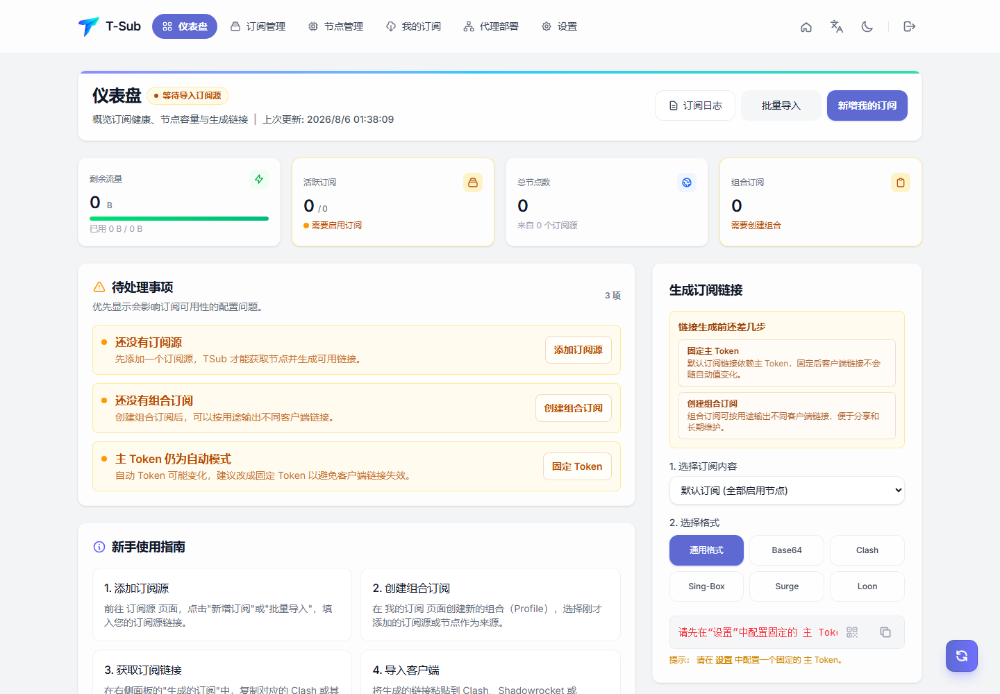
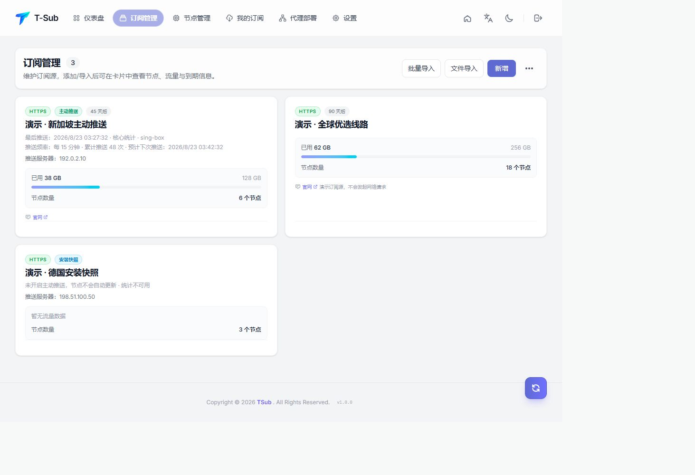
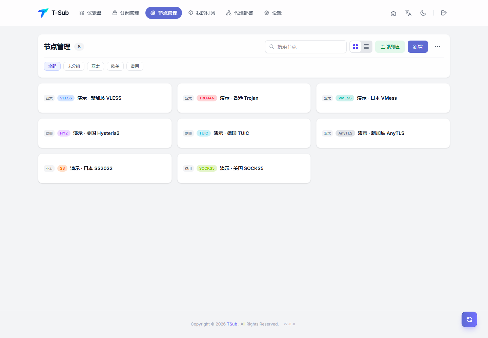
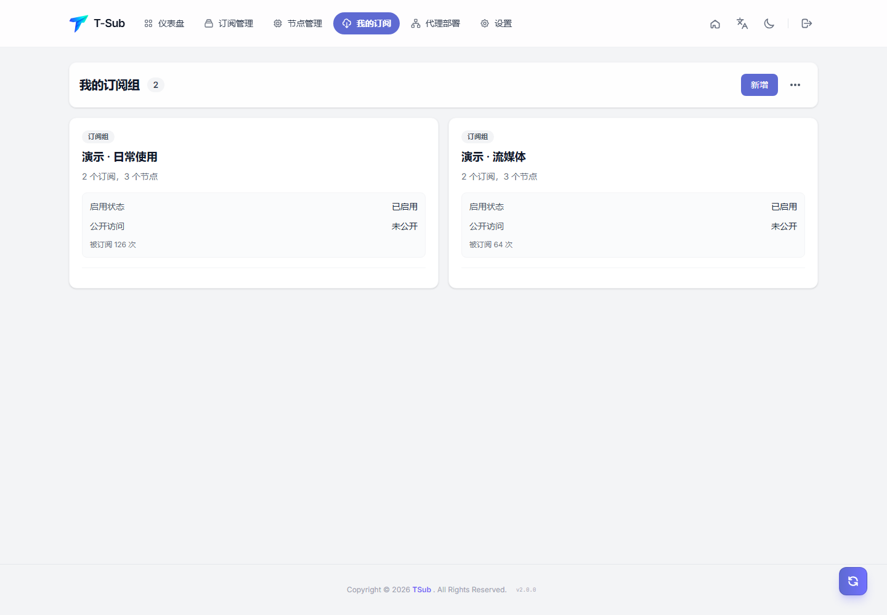
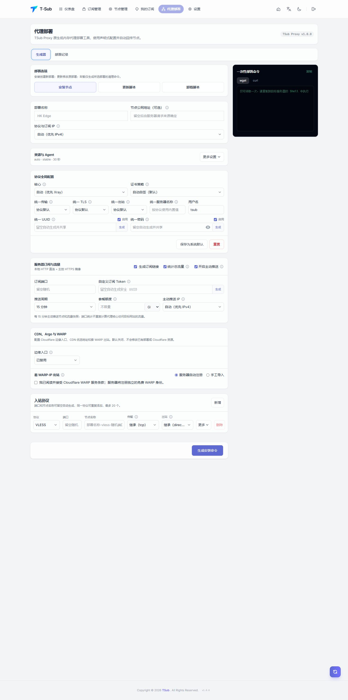

[简体中文](README.md)

<p align="center"></p>

<h1 align="center">TSub</h1>

<p align="center">
  <a href="LICENSE"></a>
  <a href="#deployment-guide"></a>
  <a href="docs/SERVER_DEPLOYMENT_EN.md#docker-compose"></a>
  <a href="https://vuejs.org/"></a>
  <a href="#release-notes"></a>
</p>

TSub is a subscription and proxy-node management platform for Cloudflare Pages or a self-hosted server. It includes Profiles, conversion, proxy deployment, remote agents, local execution, notifications, backups, and an external management API.

<p align="center"><a href="#core-capabilities">Core Capabilities</a> · <a href="#deployment-guide">Deployment Guide</a> · <a href="#local-development">Local Development</a> · <a href="docs/USER_GUIDE_EN.md">User Guide</a> · <a href="docs/PROXY_DEPLOYMENT_EN.md">Proxy Deployment</a> · <a href="docs/API_REFERENCE_EN.md">API Reference</a> · <a href="docs/ARCHITECTURE_EN.md">Architecture</a> · <a href="docs/SECURITY_EN.md">Security</a> · <a href="docs/OPERATIONS_EN.md">Operations</a> · <a href="docs/DEVELOPMENT_EN.md">Development</a> · <a href="#release-notes">Release Notes</a></p>



## Core capabilities

- Manage HTTP sources, manual nodes, and shareable Profiles.
- Produce Base64, Clash/Mihomo, sing-box, Surge, Loon, and Quantumult X output.
- Build subscriptions with operator chains, rule templates, filtering, sorting, deduplication, and renaming.
- Deploy Xray or sing-box to low-memory servers with TSub Proxy, without storing SSH credentials.
- Assign one single-hop chain upstream per inbound from an existing deployment, subscription node, manual node, or pasted link; upstream failure never falls back to the entry server's direct egress.
- Synchronize nodes and aggregate traffic through one-time Bootstrap tokens, encrypted deployment configuration, active push, and HTTPS mirrors.
- Use Cloudflare KV basic mode or D1 full mode; self-host with single-instance SQLite WAL or multi-instance PostgreSQL.
- Use the Chinese/English responsive interface and fully isolated read-only demo data.

## Interface preview

| Subscription management | Node management |
| --- | --- |
|  |  |

| My subscriptions | Proxy deployments |
| --- | --- |
|  |  |

## Deployment Guide

### Deployment Method Comparison

| Item | Cloudflare Pages | Docker Compose | Debian/Ubuntu/Alpine bare metal |
| --- | --- | --- | --- |
| Best for | Fast launch without server administration | Recommended self-hosted deployment | Full control of system services |
| Controller runtime | Cloudflare Workers/Pages Functions | Unprivileged Controller container | Restricted `tsub-controller` user |
| Default storage | KV basic mode or D1 full mode | SQLite WAL | SQLite WAL, optional PostgreSQL |
| Remote Agent | Supported with D1 | Supported | Supported |
| HTTPS | Provided by Cloudflare | Caddy in Compose | Configure Caddy or Nginx |
| Local root executor | Not applicable | Install separately on the host | Installer can register systemd/OpenRC services |
| Operations | Configure Pages bindings and variables | Docker Engine and Compose v2 | Node.js 22, npm, Git, and a service manager |

### Deployment Method 1: Cloudflare Pages

Fork this repository first, then authorize GitHub in Cloudflare and select your public fork. This README contains the complete deployment tutorial for build settings, D1/KV bindings, Secrets, first sign-in, and troubleshooting.

> [!CAUTION]
> Storage configuration now uses **Cloudflare dashboard bindings**. The public repository no longer ships an active `wrangler.toml` because Pages locks dashboard bindings whenever that file is detected. Select resources owned by your account under Pages **Settings → Bindings**; older forks must remove their existing `wrangler.toml` after syncing.

Use `npm run build` as the build command, `dist` as the output directory, and Node.js 22 or later. `wrangler.example.toml` is local reference only. Every fork must create and bind its own `TSUB_DB` or `TSUB_KV` resources in its Cloudflare Pages project.

Proxy core versions, download URLs, and SHA-256 checksums are built into the application. Regular Cloudflare users do not need to add public asset variables such as `TSUB_XRAY_*`, `TSUB_SINGBOX_*`, or `TSUB_BUSYBOX_*`. Maintainers may provide a complete variable group for a custom mirror or version; incomplete override groups fail with a clear error. Administrator passwords, Cookie keys, deployment keys, and settings keys must remain Secrets.

Use an administrator username of 3-32 characters (`a-z`, `0-9`, `.`, `_`, or `-`), a password of 8-128 characters without leading or trailing spaces, and at least 16 characters for each encryption Secret. The server initialization script requires an explicitly supplied administrator password to be at least 12 characters.

After the first sign-in, before generating a proxy deployment command, open the **Web Access Control** card at the top of **Settings → Basic settings**, enter the “Controller default address”, for example `https://your-project-address`, and save. Open `https://your-project-address/login` to sign in. This address is used for remote Agent callbacks and deployment commands; if left empty, the current address is used. Confirm the active storage under **Settings → System settings**; D1 mode should also show remote Agent and deployment-command capabilities.

The server controller supports Docker Compose and bare-metal Debian, Ubuntu, or Alpine. Its web process is unprivileged and delegates host changes to a separate root executor. Node installers first probe the controller, then use the AWS Global API (`https://checkip.global.api.aws`) and Akamai (`https://whatismyip.akamai.com`) as IPv4/IPv6 fallbacks. These report egress IPs, so confirm the reachable address manually behind NAT or proxies. See [Server Controller Deployment](docs/SERVER_DEPLOYMENT_EN.md) and [Architecture](docs/ARCHITECTURE_EN.md).

### Deployment Method 2: Docker Compose

Use Docker Engine and Compose v2 on Linux `amd64` or `arm64`. Initialize `.env` with `TSUB_DOMAIN`, administrator credentials, and independent encryption Secrets, then run `docker compose config` and `docker compose up -d --build`. Compose runs the controller as an unprivileged container, uses Caddy for HTTPS, persists SQLite and Caddy data in named volumes, and exposes only ports 80/443. Port 8787 remains internal.

### Deployment Method 3: Debian/Ubuntu/Alpine Bare Metal

Install Node.js 22, npm, Git, and the platform service manager, then run `scripts/install-controller.sh`. The installer creates the restricted `tsub-controller` user and registers systemd or OpenRC services. Configure Caddy or Nginx to proxy HTTPS to `127.0.0.1:8787`; PostgreSQL is optional for multi-instance deployments. See the [full server deployment reference](docs/SERVER_DEPLOYMENT_EN.md) for executor installation and verification commands.

### Single-hop Chain Proxy

Each inbound may select one chain upstream, producing a single-hop path: “Client → TSub entry server → upstream proxy → destination.” Sources include existing deployments, subscription nodes, manual nodes, and pasted links. Complete credentials remain only in the target deployment's encrypted configuration, while source lists, public templates, logs, and operation history expose redacted summaries.

Both Xray and sing-box support VLESS, VMess, Trojan, Shadowsocks, SOCKS5, HTTP/HTTPS, Hysteria2, and WireGuard upstreams. TUIC, AnyTLS, Naive, and Snell upstreams require sing-box; SSR/SSD are not supported. Automatic core selection intersects the server inbound with upstream-client capabilities. No direct backup route is emitted, so an unavailable upstream fails closed instead of leaking the entry server's egress IP. Source changes are not followed automatically; select the source again and run **Update Configuration**. See the [proxy deployment guide](docs/PROXY_DEPLOYMENT_EN.md#single-hop-chain-proxy) for the compatibility table and troubleshooting.

### Release Notes

Current version `1.0.16`: each proxy inbound can use one single-hop chain upstream sourced from an existing deployment, a non-deployment subscription node, a manual node, or a pasted link. TSub stores an encrypted snapshot and computes the compatible Xray/sing-box core from both the server inbound and upstream client protocol. Chain routes have no selector, fallback, or direct backup, so an unavailable upstream fails closed. Agent heartbeats and diagnostics expose only redacted chain counts, protocols, source types, DNS/port checks, and route-tag checks.

## Local development

```bash
npm ci
npm run dev
npm run test:run
npm run build
```

For local Pages Functions:

```bash
npm run dev:server -- --ip 127.0.0.1 --kv TSUB_KV --persist-to .wrangler/state-local
```

## Documentation

- [Deployment Guide](#deployment-guide)
- [User Guide](docs/USER_GUIDE_EN.md)
- [Proxy Deployment](docs/PROXY_DEPLOYMENT_EN.md)
- [Architecture](docs/ARCHITECTURE_EN.md)
- [API Reference](docs/API_REFERENCE_EN.md)
- [Data Model](docs/DATA_MODEL_EN.md)
- [Security Model](docs/SECURITY_EN.md)
- [Operations](docs/OPERATIONS_EN.md)
- [Development](docs/DEVELOPMENT_EN.md)

License: [MIT](LICENSE) · Reference: [MiSub](https://github.com/imzyb/MiSub)
