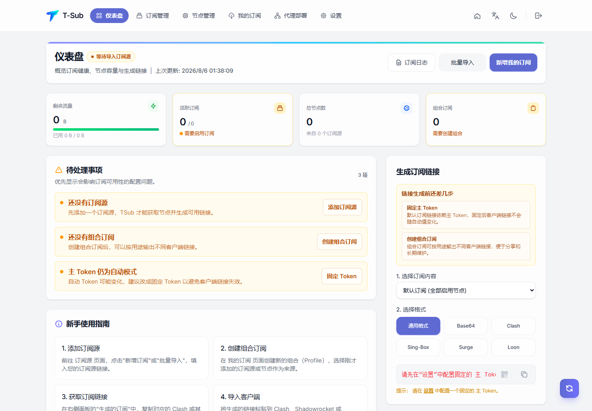
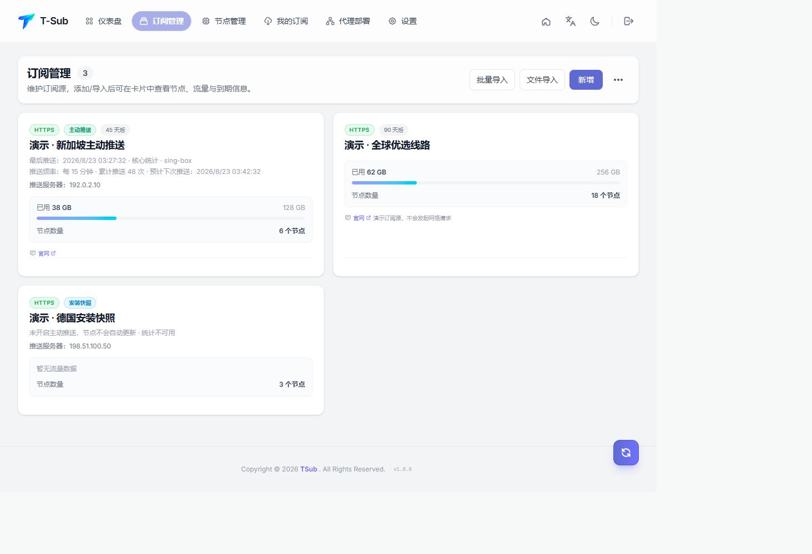
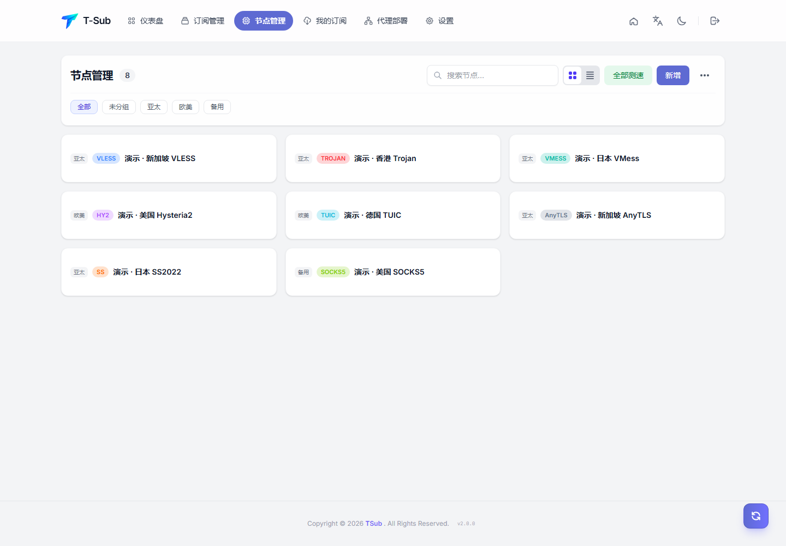
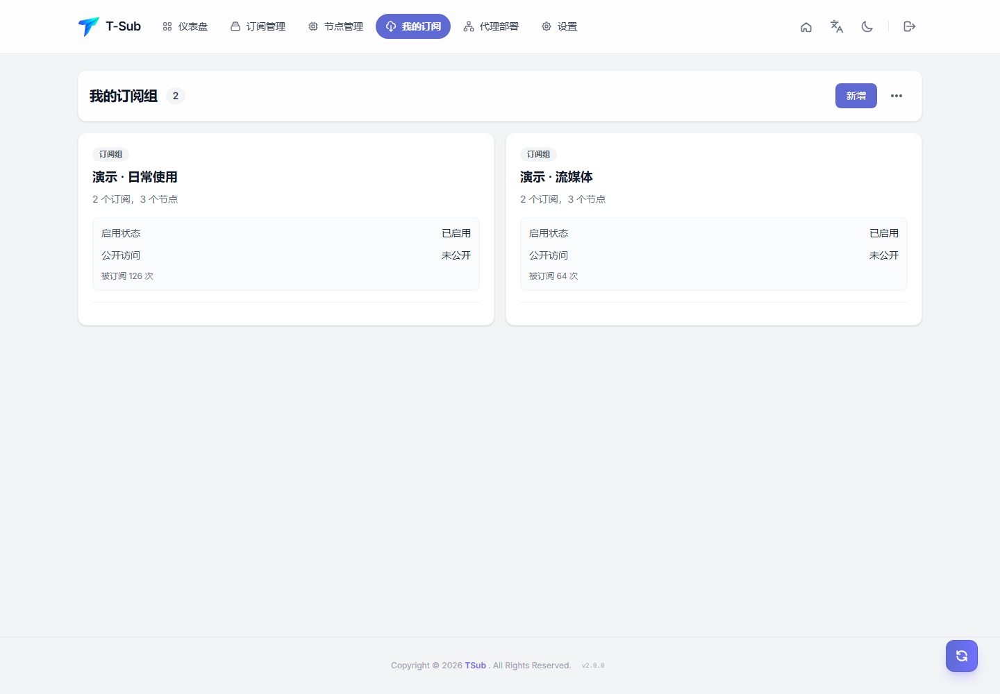
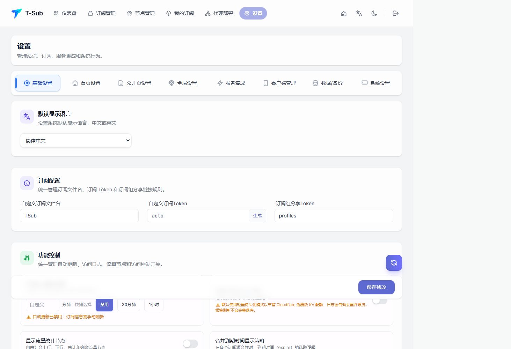
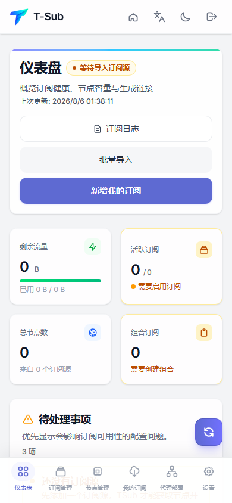

[简体中文](USER_GUIDE.md)

# User Guide

## Navigation

- **Dashboard** shows source, node, Profile, traffic, and recent status summaries.
- **Subscription Management** manages HTTP sources, active-push sources, and installation snapshots.
- **Node Management** manages individual share links, groups, latency, and batch actions.
- **My Subscriptions** combines sources and nodes into client output.
- **Proxy Deployments** generates server deployment commands and shows deployment and operation history.
- **Settings** manages the site, public page, conversion, integrations, clients, backups, and authentication.

## Subscription management

Sources can be added individually, pasted in bulk, or imported from files. Normal sources can be refreshed, edited, or disabled. Deployment-managed push sources are controlled by their deployments. Cards show server address, accepted push count, five recent pushes, frequency, next expected push, and traffic backend.

Demo sources are read-only and cannot be copied, refreshed, edited, or deleted.

## Node management

Share links include VLESS, Trojan, VMess, Hysteria2, TUIC, AnyTLS, Shadowsocks, and SOCKS5. Nodes support grouping, filtering, ordering, deduplication, batch moves, and connectivity checks. Demo nodes expose no copy, ping, edit, or delete action.

## My subscriptions

A Profile combines sources and manual nodes, client templates, rules, operator chains, and public visibility. Download counts and access logs support operations. Disabling a Profile immediately stops public output. Demo Profiles never produce public links.

## Proxy deployment generator

The generator uses “Manual Configuration” by default. To copy public settings from an existing node, choose “Reuse Existing Deployment”, select a controller-saved V2 template, then check the individual inbound protocols to reuse and choose whether to reuse transport, public TLS/REALITY settings, outbound policy, ports, or node names. All inbounds are selected by default and at least one must remain selected. Reuse always creates a new deployment record and never changes the source or reads live server configuration.

Ports, UUIDs, passwords, Reality/WARP private keys, subscription tokens, and managed Tunnel resources are not reused by default. They are regenerated or requested again for the new deployment. The same protocol, port, core, and WARP terms validation still applies, and templates contain only redacted fields.

Each inbound can also select **Chain Proxy** as its individual outbound and choose one upstream from an existing deployment, a subscription node, a manual node, or a pasted link. After preview confirmation, the controller stores an encrypted upstream snapshot in the target deployment. Later source changes or deletion do not alter an installed node automatically. If the upstream is unavailable, the connection fails closed and never falls back to the entry server's direct egress. Select the source again and run **Update Configuration** to switch upstreams.

## Conversion and operators

Built-in converters produce common client formats. Operators run in order and can filter protocols or names, identify regions, sort, deduplicate, rename, and merge rules. Remote scripts and Fetch Proxy access external networks and must point only to trusted endpoints.

## Settings and demo data

The Demo Data section can idempotently generate, refresh, or clear an isolated dataset. Demo records never enter public subscriptions, Cron, Telegram, WebDAV, system exports, the External API, or deployment callbacks. Screenshot requests use a dedicated header to return demo-only content and redacted settings.

## Mobile

Narrow screens use a top brand bar and bottom navigation. Lists, deployment controls, and settings tabs wrap without horizontal overflow.

